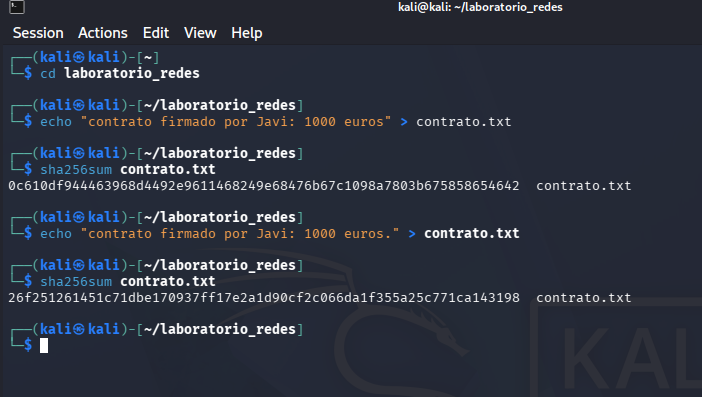
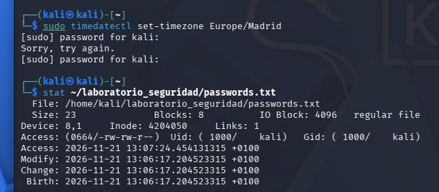

# 🔐 Laboratorio 02: Control de Integridad (SHA-256) y Detección Forense con Honeyfiles

## 1. Objetivo
Demostrar el funcionamiento práctico de las funciones hash criptográficas para garantizar la integridad de los datos (Tríada CIA) e implementar técnicas de engaño (*Deception*) mediante archivos cebo (*honeyfiles*) monitorizados a nivel de metadatos.

## 2. Entorno utilizado
* **Sistema:** Kali Linux (Oracle VirtualBox)
* **Herramientas:** `sha256sum`, `stat`, `timedatectl`

## 3. Desarrollo técnico y hallazgos

### A. Verificación de integridad y efecto avalancha (`sha256sum`)
1. Se generó un archivo de prueba (`contrato.txt`) calculando su huella digital SHA-256 original (`0c610df9...`).
2. Tras modificar un único carácter del documento (añadiendo un punto final), el nuevo hash cambió por completo (`26f25126...`), demostrando cómo cualquier alteración mínima invalida la integridad del archivo.

### B. Despliegue de Honeyfile y análisis forense de marcas de tiempo (`stat`)
1. Se desplegó un archivo señuelo con nombre atractivo (`passwords.txt`) en un directorio controlado (`~/laboratorio_seguridad`).
2. Tras simular un acceso no autorizado de lectura (`cat`), se inspeccionaron los metadatos del sistema de archivos mediante `stat`.
3. **Hallazgo clave:** Mientras las marcas de tiempo de creación (`Birth`) y modificación (`Modify`) permanecieron intactas (`13:06:17`), el registro **`Access`** se actualizó al segundo exacto de la lectura (`13:07:24`), permitiendo detectar el acceso indebido sin que el atacante modificara el archivo.
4. **Sincronización horaria:** Se ajustó la zona horaria del sistema (`Europe/Madrid`, UTC+1) mediante `timedatectl` para garantizar la trazabilidad forense de los registros.

## 4. Conclusión de seguridad
La combinación de verificación criptográfica mediante hashes y monitorización de metadatos en archivos cebo permite detectar tanto la manipulación de evidencias como el reconocimiento interno silencioso de un intruso en la red.
