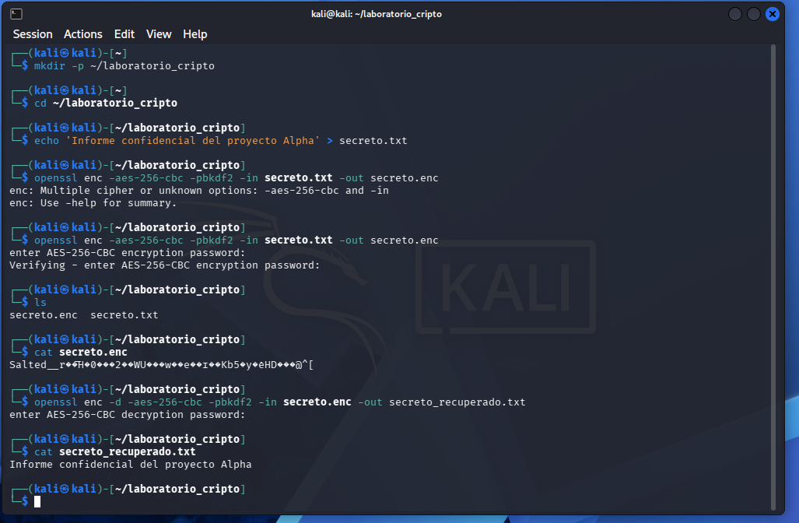

# 🔑 Laboratorio 03: Criptografía Simétrica (AES-256) y Derivación de Claves con OpenSSL

## 1. Objetivo
Implementar cifrado simétrico robusto mediante **AES-256-CBC** con derivación segura de claves (**PBKDF2**) y salting automático utilizando `openssl` en Kali Linux, validando el pilar de **Confidencialidad** de la Tríada CIA.

## 2. Entorno utilizado
* **Sistema:** Kali Linux (Oracle VirtualBox)
* **Herramienta:** `openssl`

## 3. Desarrollo técnico y hallazgos

### A. Cifrado de información sensible (`openssl enc`)
1. Se creó un documento en texto claro (`secreto.txt`) dentro de un entorno controlado (`~/laboratorio_cripto`).
2. Se cifró mediante el algoritmo **AES-256** en modo encadenamiento de bloques (**CBC**), aplicando **PBKDF2** para proteger la contraseña frente a ataques de fuerza bruta y diccionario.
3. **Verificación de confidencialidad:** Al inspeccionar `secreto.enc` con `cat`, el contenido aparece completamente ilegible encabezado por la firma `Salted__`, confirmando la aplicación automática de un valor aleatorio (*salt*) que impide ataques con tablas arcoíris (*rainbow tables*).

### B. Descifrado y recuperación de datos (`openssl enc -d`)
* Se ejecutó el proceso inverso utilizando la misma clave simétrica compartida, recuperando el contenido íntegro en `secreto_recuperado.txt`.

## 4. Conclusión de seguridad
El cifrado simétrico con estándares actuales como AES-256 ofrece un rendimiento óptimo para proteger datos en reposo (*data at rest*), siendo imprescindible acompañarlo de funciones de derivación de claves (como PBKDF2) y salting para evitar que contraseñas débiles comprometan la clave criptográfica.
