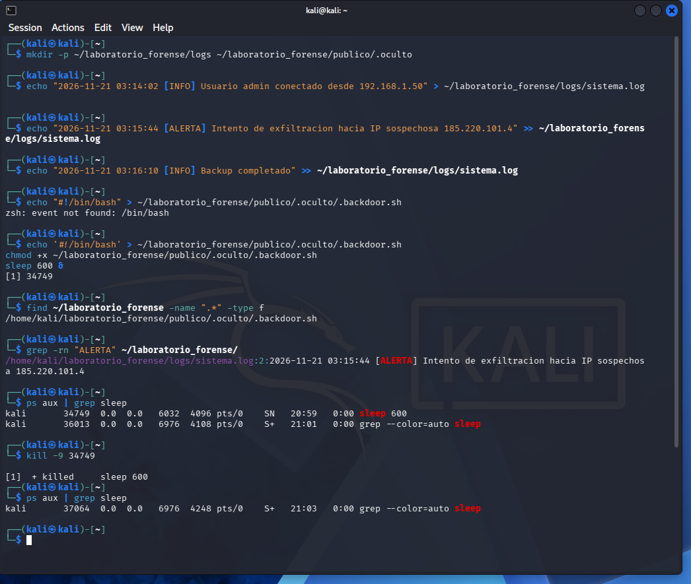

# 🔍 Laboratorio 04: Triaje Forense en Vivo y Búsqueda de Evidencias en Linux

## 1. Objetivo
Simular una respuesta inicial ante incidentes (*Live Forensics / SOC Triage*) en un entorno Linux para localizar archivos ocultos maliciosos, rastrear indicadores de compromiso (IoC) en registros del sistema y neutralizar procesos no autorizados en ejecución.

## 2. Entorno utilizado
* **Sistema:** Kali Linux (Oracle VirtualBox)
* **Herramientas:** `find`, `grep`, `ps`, `kill`

## 3. Desarrollo técnico y hallazgos

### A. Localización de persistencia y archivos ocultos (`find`)
1. Se ejecutó una búsqueda recursiva filtrando archivos regulares cuyo nombre comenzara por punto (`find ~/laboratorio_forense -name ".*" -type f`).
2. **Hallazgo:** Se descubrió el script ejecutable oculto `/home/kali/laboratorio_forense/publico/.oculto/.backdoor.sh`, invisible ante un listado estándar (`ls`).

### B. Análisis de registros y extracción de IoC (`grep`)
1. Mediante `grep -rn "ALERTA" ~/laboratorio_forense/` se analizaron de forma recursiva los registros de actividad indicando el número exacto de línea.
2. **Hallazgo:** En la **línea 2** de `sistema.log` se identificó un evento crítico (`03:15:44 [ALERTA]`) revelando un intento de exfiltración de datos hacia la dirección IP externa sospechosa **`185.220.101.4`**.

### C. Detección y erradicación de procesos activos (`ps` y `kill`)
1. Se inspeccionó la tabla completa de procesos en memoria (`ps aux | grep sleep`), identificando un proceso persistente en segundo plano (`sleep 600`) ejecutándose bajo el **PID `34749`**.
2. Se forzó la terminación inmediata del proceso mediante `kill -9 34749` y se verificó mediante una segunda consulta `ps aux` que el proceso malicioso había sido erradicado por completo de la memoria.

## 4. Conclusión de seguridad
El dominio de las utilidades nativas de línea de comandos en Linux permite a un analista SOC realizar triajes rápidos sin depender de agentes externos, identificando mecanismos básicos de ocultación (*dot-files*), extrayendo indicadores de red de los logs y deteniendo procesos activos antes de que completen la exfiltración.
