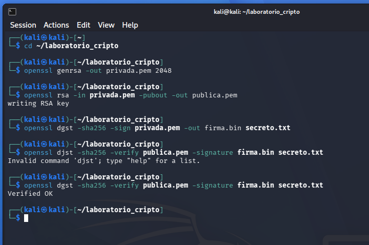

# 🔏 Laboratorio 05: Criptografía Asimétrica (RSA-2048) y Firma Digital con OpenSSL

## 1. Objetivo
Generar un par de claves asimétricas **RSA de 2048 bits** mediante `openssl`, firmar digitalmente un documento (`SHA-256`) utilizando la clave privada y verificar su autenticidad, integridad y **No Repudio** mediante la clave pública correspondiente.

## 2. Entorno utilizado
* **Sistema:** Kali Linux (Oracle VirtualBox)
* **Herramienta:** `openssl` (`genrsa`, `rsa`, `dgst`)

## 3. Desarrollo técnico y hallazgos

### A. Generación del par de claves RSA (`privada.pem` y `publica.pem`)
1. Se generó una clave privada RSA de 2048 bits (`openssl genrsa -out privada.pem 2048`), custodiada de forma exclusiva por el emisor.
2. A partir de la clave privada, se extrajo su clave pública asociada (`openssl rsa -in privada.pem -pubout -out publica.pem`) para su distribución.

### B. Firma digital y verificación de origen (`openssl dgst`)
1. **Firma:** Se calculó el resumen criptográfico `SHA-256` del archivo `secreto.txt` y se cifró con `privada.pem`, generando el archivo de firma binaria `firma.bin`.
2. **Verificación:** Empleando únicamente la clave pública (`publica.pem`), se validó la firma sobre `secreto.txt` obteniendo **`Verified OK`**, confirmando tanto la integridad del contenido como la identidad del firmante.

## 4. Conclusión de seguridad
La combinación de funciones hash (`SHA-256`) y criptografía asimétrica (`RSA`) resuelve dos pilares críticos de la seguridad: garantiza que el documento no haya sido alterado en tránsito y proporciona **No Repudio**, impidiendo que el poseedor de la clave privada niegue la autoría de la firma.
